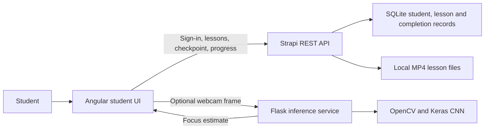

# IntelliKids Software Requirements and Design Specification

**First increment for the 30% milestone review**

Department of Computer Science, COMSATS University Islamabad, Wah Campus

## Scope and development model

IntelliKids supports primary-school learners through lessons, formative assessment and progress feedback. The first milestone demonstrates the student learning flow. Later releases add content management, richer assessment and teacher and parent reporting.

The project follows the **Incremental Development Model**. Each increment has requirements, design, implementation and acceptance tests. The sprints in the FYP proposal can be used to plan work within each increment. The completed student flow provides evidence for the first review and a base for the next release.

| Increment | Scope |
| --- | --- |
| 1 | Student login, dashboard, course catalogue, two published lessons, live focus feedback, objective checkpoints and saved lesson completion |
| 2 | Teacher content workflows, larger lesson library, browser tab visibility and lesson session summaries |
| 3 | Explainable grading for written and spoken answers |
| 4 | STEM content, educational blogs and adaptive recommendations |
| 5 | Parent and teacher reporting, Urdu localization, integration and evaluation |

The first increment is a proposed submission for the 30% review. Apply the supervisor or committee's rubric to assess the implementation percentage.

## Users and functional requirements

The student starts at the original landing page, signs in, selects a lesson, watches the video and completes a checkpoint. Optional camera feedback uses local inference during playback. The Progress screen lists results saved for the signed-in student. Teachers and parents are actors in later increments.

| ID | Requirement | Increment |
| --- | --- | --- |
| FR-01 | Authenticate the student through Strapi, protect dashboard and lesson routes and support sign-out. | 1 |
| FR-02 | List published lessons and support play, pause and seek for local media. | 1 |
| FR-03 | Capture camera frames only during opted-in playback, show the latest model result and release the camera on pause, finish, disable or exit. | 1 |
| FR-04 | Grade the selected checkpoint answer on the backend and return feedback. | 1 |
| FR-05 | Persist a successful checkpoint completion and show the student's own progress after reload. | 1 |
| FR-06 | Support teacher-managed lessons, browser tab visibility and per-lesson session summaries. | 2 |
| FR-07 | Evaluate written and spoken answers and explain the score using a rubric. | 3 |
| FR-08 | Present curated STEM resources and suggest learning activities from lesson and assessment results. | 4 |
| FR-09 | Present role-appropriate reports and support Urdu localization. | 5 |

## Quality requirements

| ID | Requirement |
| --- | --- |
| NFR-01 | After setup, run the demo on one Windows laptop using local application services, lesson media and fonts. |
| NFR-02 | Ask explicitly before accessing the camera. Process frames in memory and discard them. |
| NFR-03 | Send at most one inference request at a time. Keep playback usable when camera access is denied, a frame cannot be classified or the vision service is unavailable. |
| NFR-04 | Provide labeled controls, visible focus, readable errors and live status feedback. |

The focus result estimates visual orientation from visible eye patches. If face or eye detection fails, the service returns unavailable. Classroom accuracy and ethical use of focus feedback require evaluation before wider deployment.

## Architecture and data

Strapi's Users & Permissions plugin manages the student session. The Content records hold the video path and lesson metadata. Checkpoint definitions and correct choices reside on the server. The first correct answer records one completion per student and lesson. Repeated correct submissions leave the existing completion in place.

| Interface | Purpose |
| --- | --- |
| `POST /api/auth/local` | Validate credentials and issue a JWT. |
| `GET /api/contents`, `GET /api/contents/:id` | Return published course and lesson metadata to authenticated students. |
| `GET /api/contents/:id/checkpoint` | Return the prompt, choices and current completion flag. |
| `POST /api/contents/:id/checkpoint` | Accept a choice, evaluate it and persist a correct submission. |
| `GET /api/lesson-progress` | Return the signed-in student's completed lessons. |
| `POST /process_image` | Accept a webcam JPEG and return focused, distracted or unavailable. |

## First increment acceptance tests

| Check | Requirements | Pass condition |
| --- | --- | --- |
| AC-01 | FR-01 | Reject invalid credentials, open the dashboard after login and protect direct lesson URLs after sign-out. |
| AC-02 | FR-02, NFR-01 | Show both published lessons and control playback without an external media host. |
| AC-03 | FR-03, NFR-02, NFR-03, NFR-04 | Show a focus result after consent. Show unavailable for an out-of-view frame. Stop capture on pause and allow continued playback when permission is denied. |
| AC-04 | FR-04, FR-05 | Reject an incorrect choice without marking the lesson complete. Persist a correct choice and show the completed lesson after reloading Progress. |

See the [SRS brief](PARTNER-SRS-BRIEF.md) for the team handoff and committee questions.
